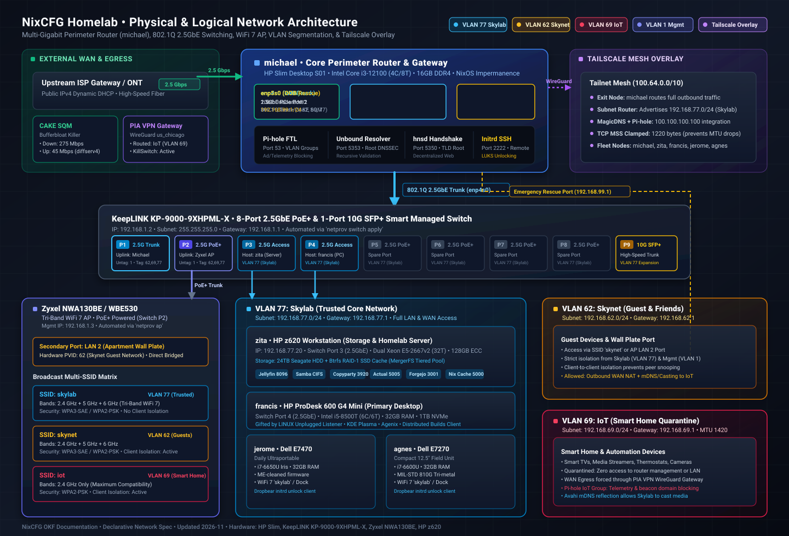

# Home Network Topology & Infrastructure 🌐🛡️

The **NixCFG Homelab Network** is an enterprise-grade, multi-gigabit private infrastructure engineered for resilience, strict zero-trust isolation, bufferbloat-free throughput, and automated declarative provisioning.

Anchored by `michael`—an HP Slim desktop converted into a dedicated NixOS router—the network employs 2.5GbE backbone trunking, 802.1Q VLAN segmentation, WiFi 7 wireless distribution, layered DNS ad-blocking, and an encrypted Tailscale overlay mesh.

---

## Visual Architecture Diagram

Below is the complete architectural topology map illustrating external WAN connectivity, core routing interfaces, managed switching, wireless AP distribution, VLAN security zones, and homelab endpoints:



> 🚀 **Interactive Architecture Explorer**: For pan/zoom navigation, interactive layer filtering (Physical Ports, VLANs, Security Flows, Tailscale Mesh), and deep component inspection, launch the standalone web explorer:
> 👉 **[`docs/architecture/network-diagram.html`](./network-diagram.html)**

---

## 1. Physical Hardware Topology

The physical infrastructure consists of a multi-gigabit core backbone connecting the router, smart managed switch, wireless access point, and high-performance server/workstation nodes:

```
                  [ Public Fiber ONT / ISP Modem ]
                                 | (2.5 Gbps Line Rate)
                                 v
                 +-------------------------------+
                 |  michael (Core NixOS Router)  |
                 |  HP Slim S01 • Intel i3-12100 |
                 +-------------------------------+
                      |                    |
       [enp4s0: 2.5GbE Trunk]      [enp5s0: 1GbE Onboard]
                      |                    |
                      v                    v
         +--------------------------+  [Emergency OOB Rescue]
         | KeepLINK KP-9000 Managed |   192.168.99.1/24
         | 8x 2.5G PoE+ & 1x 10G    |
         +--------------------------+
           |     |     |     |    |
           |     |     |     |    +--> Port 9: 10G SFP+ Uplink
           |     |     |     +-------> Ports 5-8: Spare 2.5G PoE+
           |     |     +-------------> Port 4: francis (Workstation)
           |     +-------------------> Port 3: zita (Server / Storage)
           +-------------------------> Port 2: Zyxel WiFi 7 AP (PoE+)
                                          |
                                          +--> Radio: Tri-Band WiFi 7
                                          +--> LAN 2: Skynet Wall Plate
```

### Physical Port Allocation & Switch Matrix

The central switching fabric is a **KeepLINK KP-9000-9XHPML-X** smart managed switch with 8× 2.5GbE PoE+ ports and 1× 10G SFP+ uplink ([`hosts/michael/network.nix`](../../hosts/michael/network.nix)):

| Port | Physical Type | Mode | Native PVID | Tagged VLANs | PoE+ State | Connected Device & Purpose |
| :--- | :--- | :--- | :--- | :--- | :--- | :--- |
| **P1** | 2.5GbE RJ-45 | Trunk | 1 (Mgmt) | 62, 69, 77 | Disabled | **Uplink to michael**: Dedicated LAN interface `enp4s0`. |
| **P2** | 2.5GbE RJ-45 | Trunk | 1 (Mgmt) | 62, 69, 77 | **Enabled** | **Zyxel NWA130BE AP**: 2.5G PoE+ power and multi-VLAN trunk. |
| **P3** | 2.5GbE RJ-45 | Access | 77 (Skylab) | None | Disabled | **`zita` Server**: HP z620 (Storage, Jellyfin, Actual, Nix Cache). |
| **P4** | 2.5GbE RJ-45 | Access | 77 (Skylab) | None | Disabled | **`francis` Workstation**: HP ProDesk 600 G4 Mini daily desktop. |
| **P5** | 2.5GbE RJ-45 | Access | 77 (Skylab) | None | **Enabled** | **Spare 2.5G PoE+**: Reserved for test bench / workbench. |
| **P6** | 2.5GbE RJ-45 | Access | 77 (Skylab) | None | **Enabled** | **Spare 2.5G PoE+**: Reserved for auxiliary cameras/APs. |
| **P7** | 2.5GbE RJ-45 | Access | 77 (Skylab) | None | **Enabled** | **Spare 2.5G PoE+**: Expansion port. |
| **P8** | 2.5GbE RJ-45 | Access | 77 (Skylab) | None | **Enabled** | **Spare 2.5G PoE+**: Expansion port. |
| **P9** | 10G SFP+ | Trunk | 77 (Skylab) | None | N/A | **High-Speed Storage Uplink**: Reserved for 10GbE NAS/SAN expansion. |

### Router Physical Interfaces (`michael`)

| Interface | Hardware Spec | IP Configuration | Connected To / Function |
| :--- | :--- | :--- | :--- |
| **`enp3s0`** | 2.5GbE PCIe Port 1 (Bottom) | Dynamic DHCP Client | Upstream ISP Modem / ONT (External WAN) |
| **`enp4s0`** | 2.5GbE PCIe Port 2 (Top) | `192.168.1.1/24` (Native) | KeepLINK Switch Port 1 (802.1Q Managed Trunk) |
| **`enp5s0`** | 1.0GbE Realtek Onboard NIC | `192.168.99.1/24` (Static) | **Emergency Out-of-Band (OOB) Rescue Port** |

---

## 2. Logical VLAN Segmentation & Addressing

The network is segregated into distinct broadcast domains to isolate untrusted appliances, prevent lateral threat movements, and prioritize critical homelab services:

| VLAN ID | Name | Subnet Range | Gateway IP | DHCP Pool | Target Devices & Security Tier |
| :---: | :--- | :--- | :--- | :--- | :--- |
| **1** | `mgmt` | `192.168.1.0/24` | `192.168.1.1` | `.10` – `.50` | **Infrastructure Management**: KeepLINK switch (`.2`), Zyxel AP (`.3`). |
| **77** | `skylab` | `192.168.77.0/24` | `192.168.77.1` | `.100` – `.250` | **Trusted Core**: Workstations (`francis`), servers (`zita` `.20`), laptops (`jerome`, `agnes`). |
| **62** | `skynet` | `192.168.62.0/24` | `192.168.62.1` | `.100` – `.250` | **Guest & Friends**: Guest Wi-Fi clients, AP LAN 2 wall plate. Client isolation enabled. |
| **69** | `iot` | `192.168.69.0/24` | `192.168.69.1` | `.100` – `.250` | **Smart Home Quarantine**: Smart TVs, speakers, sensors, cameras. MTU 1420. |
| — | `oob` | `192.168.99.0/24` | `192.168.99.1` | Static only | **Emergency Rescue**: Direct physical recovery port on `enp5s0`. |
| — | `tailscale` | `100.64.0.0/10` | CGNAT Mesh | Automatic | **Encrypted Overlay Mesh**: Zero-trust remote access across the entire fleet. |

### Static Infrastructure Reservations

* **`192.168.1.1`**: `michael` Router Management Interface (`enp4s0`)
* **`192.168.1.2`**: KeepLINK KP-9000 Smart Switch
* **`192.168.1.3`**: Zyxel NWA130BE AP (Static DHCP lease keyed to MAC `80:ea:0b:4b:b2:bb`)
* **`192.168.77.1`**: `michael` Skylab Gateway Interface (`enp4s0.77`)
* **`192.168.77.20`**: `zita` Homelab Storage & Service Server (`zita.skylab.home`)
* **`192.168.99.1`**: `michael` Emergency OOB Rescue Interface (`enp5s0`)

---

## 3. Wireless Architecture & Radio Band Allocations

Wireless connectivity is broadcast by a **Zyxel NWA130BE / WBE530** enterprise Tri-Band WiFi 7 Access Point powered over PoE+ via Switch Port 2:

```
                        [ Zyxel NWA130BE WiFi 7 AP ]
                                     |
         +---------------------------+---------------------------+
         |                           |                           |
  [ Radio Slot 1 ]            [ Radio Slot 2 ]            [ Radio Slot 3 ]
     2.4 GHz                     5.0 GHz                     6.0 GHz
         |                           |                           |
         +--> skylab (VLAN 77)       +--> skylab (VLAN 77)       +--> skylab (VLAN 77)
         +--> skynet (VLAN 62)       +--> skynet (VLAN 62)       +--> skynet (VLAN 62)
         +--> iot    (VLAN 69)
```

### SSID Configuration Matrix

| SSID | VLAN ID | Security Mode | Frequency Bands | Client Isolation | Intended Devices & Policy |
| :--- | :---: | :--- | :--- | :---: | :--- |
| **`skylab`** | **77** | WPA3-SAE / WPA2-PSK | 2.4 GHz, 5 GHz, 6 GHz (WiFi 7) | **False** | Family trusted devices, personal laptops, phones. Full access to `zita` storage. |
| **`skynet`** | **62** | WPA3-SAE / WPA2-PSK | 2.4 GHz, 5 GHz, 6 GHz | **True** | Guests and visitors. Direct internet NAT only; peer devices cannot snoop on each other. |
| **`iot`** | **69** | WPA2-PSK | **2.4 GHz Only** | **True** | Smart plugs, thermostats, lighting, vacuums. Locked to 2.4 GHz for broad compatibility. |

### Secondary Physical Port: LAN 2 Wall Plate

The Zyxel AP includes a secondary physical Ethernet jack (**LAN 2**). Through declarative provisioning ([`hosts/michael/network.nix`](../../hosts/michael/network.nix)), this jack is mapped to **VLAN 62 (Skynet)**:
* Bridges directly to an apartment wall jack.
* Provides visitor wired Ethernet without giving them access to the trusted `skylab` subnet.
* Enforces client isolation and guest firewall policies at the hardware port level.

---

## 4. Firewall Zones & Traffic Flow Policy

Packet filtering is enforced on `michael` via Linux kernel `nftables` ([`hosts/michael/routing.nix`](../../hosts/michael/routing.nix)):

```
[ Source Zone ]       -->  [ Destination Zone ]         -->  [ Policy / Action ]
===================================================================================
Skylab (VLAN 77)      -->  WAN (Internet)               -->  ACCEPT (CAKE Shaped)
Skylab (VLAN 77)      -->  Skynet, IoT, Mgmt            -->  ACCEPT (Full Access)
Skylab (VLAN 77)      -->  Tailscale Mesh               -->  ACCEPT (Bidirectional)
-----------------------------------------------------------------------------------
Skynet (VLAN 62)      -->  WAN (Internet)               -->  ACCEPT (Direct NAT)
Skynet (VLAN 62)      -->  IoT (VLAN 69)                -->  ACCEPT (mDNS / Casting)
Skynet (VLAN 62)      -->  Skylab (VLAN 77)             -->  DROP (Strict Quarantine)
Skynet (VLAN 62)      -->  Router Admin (22, 80, 443)  -->  DROP
-----------------------------------------------------------------------------------
IoT (VLAN 69)         -->  PIA VPN WireGuard Tunnel     -->  ACCEPT (Quarantined NAT)
IoT (VLAN 69)         -->  WAN Direct                   -->  REJECT (VPN Killswitch)
IoT (VLAN 69)         -->  Skylab, Skynet, Mgmt         -->  DROP
IoT (VLAN 69)         -->  Router Admin Ports           -->  DROP (Only Gateway IP)
-----------------------------------------------------------------------------------
Tailscale Overlay     -->  Skylab (VLAN 77)             -->  ACCEPT (Subnet Route)
Tailscale Overlay     -->  WAN (Internet)               -->  ACCEPT (Exit Node)
Tailscale Overlay     -->  DNS (Port 53)                -->  REDIRECT -> Local Pi-hole
```

### Tailscale Exit Node & MSS Clamping

When remote devices on the Tailnet route internet traffic through `michael`:
1. **DNS Interception**: Port 53 queries originating on `tailscale0` are redirected transparently to `michael`'s local Pi-hole instance, preserving ad blocking on mobile devices anywhere in the world.
2. **TCP MSS Clamping**: TCP MSS is clamped to **1220 bytes** (`tcp option maxseg size set 1220`) in both directions. This prevents packet fragmentation and "MTU black holes" across cellular and public Wi-Fi hotspots.
3. **NAT Masquerade**: Traffic from `tailscale0` to internal subnets is masqueraded so LAN nodes (like `zita`) reply back through `michael`.

---

## 5. Multi-Tiered DNS & Ad-Blocking Pipeline

DNS resolution on `michael` uses a layered defense-in-depth pipeline ([`hosts/michael/dns.nix`](../../hosts/michael/dns.nix)):

```
[ LAN Clients ] (DNS Port 53)
       |
       v
+--------------------------------------------------------+
|  Pi-hole FTL (Port 53)                                 |
|  - VLAN Group Rules: Skylab, Skynet, IoT               |
|  - Local hostnames: zita.home, michael.home            |
|  - Forwarding: Tailscale MagicDNS (100.100.100.100)   |
+--------------------------------------------------------+
       |
       +---> [ Local Cache Hit / Static CNAME ] ---------> Return IP
       |
       v (Query Cache Miss)
+--------------------------------------------------------+
|  Unbound Recursive DNSSEC Resolver (Port 5353)         |
|  - Resolves directly against root nameservers          |
|  - Strict DNSSEC cryptographic validation              |
|  - Prefetching & aggressive caching                    |
+--------------------------------------------------------+
       |
       v (Alternative TLD Queries)
+--------------------------------------------------------+
|  hnsd Handshake Decentralized Resolver (Port 5350)     |
|  - Native root resolution for decentralized Web3 TLDs  |
+--------------------------------------------------------+
```

### VLAN-Aware Blocklist Groups (`pihole-groups.nix`)

Pi-hole FTL dynamically evaluates client IP addresses against group policies:
* **Skylab Group**: Blocks aggressive advertising, trackers, malicious domains, and data mining telemetry.
* **IoT Group**: Specifically targets smart TV telemetry beacons, Samsung/LG ad networks, and smart speaker analytics endpoints while preserving device media functionality.
* **Skynet Group**: Standard ad filtration plus malware and phishing domain protection.

---

## 6. Traffic Shaping with CAKE SQM

To eliminate latency spikes ("bufferbloat") during heavy git checkouts, bulk video uploads, or large Steam downloads, `michael` applies the **CAKE (Common Applications Kept Enhanced)** queue discipline to `enp3s0` ([`modules/cake-sqm.nix`](../../modules/cake-sqm.nix)):

* **Download Bandwidth**: Shaped at **275 Mbps** (just below ISP line saturation).
* **Upload Bandwidth**: Shaped at **45 Mbps**.
* **DiffServ Awareness (`diffserv4`)**: Automatically classifies flows into priority tiers:
  * *High Priority*: VoIP packets, DNS lookups, interactive SSH keystrokes, online gaming packets.
  * *Best Effort*: Standard HTTP/HTTPS browsing, streaming media.
  * *Bulk*: Cloud backups, torrents, bulk system updates.
* **TCP ACK Filtering (`ackFilter = true`)**: Conserves upstream bandwidth on asymmetric broadband by filtering redundant TCP ACK packets.

---

## 7. Declarative Provisioning Automation (`netprov`)

Rather than configuring the KeepLINK smart switch and Zyxel access point manually via clunky vendor web consoles, the entire network configuration is declared in Nix and deployed using **`netprov`** ([`pkgs/netprov/netprov.py`](../../pkgs/netprov/netprov.py)):

### Switch Management Commands

```bash
# Verify infrastructure reachability and link state
netprov status

# Push 802.1Q VLAN matrix and port PVIDs to KeepLINK switch
netprov switch apply

# Print switch port assignment plan
netprov switch generate

# Power cycle PoE on switch port 2 (e.g. to reboot the Zyxel AP)
netprov switch cycle-poe --port 2
```

### Access Point Management Commands

```bash
# Generate ZySH CLI commands for Zyxel AP staging
netprov ap generate --mode test

# Deploy production SSIDs and radio mappings to AP over SSH
netprov ap apply --mode prod
```

---

## 8. Emergency Out-of-Band (OOB) Recovery

A fundamental principle of the homelab's network architecture is **fail-safe operational continuity**:

### The Onboard Rescue Port (`enp5s0`)
If an 802.1Q misconfiguration, switch firmware crash, or trunk cable fault ever severs access to `michael`:
1. Connect any laptop directly into the motherboard’s onboard 1GbE Ethernet jack (`enp5s0`).
2. The port provides a guaranteed fallback subnet at `192.168.99.1/24`.
3. SSH is immediately accessible without requiring monitor, keyboard, or switch intervention:
   ```bash
   ssh root@192.168.99.1
   ```

### Headless Early-Boot LUKS Unlocking
When `michael` or `zita` reboot after kernel upgrades, their root filesystems remain locked:
* `michael`'s initrd starts Dropbear SSH on port 2222 across `enp4s0.77` and `enp5s0`.
* Once unlocked, `michael` runs the `zita-auto-unlock` daemon ([`hosts/michael/remote-unlock.nix`](../../hosts/michael/remote-unlock.nix)), probing `zita:2222` and automatically transmitting the LUKS passphrase to unlock the storage server without human interaction.

---

## Related Documents & Runbooks

* [Interactive Network Explorer (HTML)](./network-diagram.html)
* [Vector Network Diagram (SVG)](./network-diagram.svg)
* [Network Routing & Perimeter Defense](./network-routing.md)
* [Fleet Overview & Ethos](./fleet-overview.md)
* [Storage Architecture & Tiering](./storage-tiering.md)
* [Remote Headless LUKS Unlocking over SSH](../howto/remote-luks-unlock.md)
* [Host Profile: michael](../hosts/michael.md)
* [Host Profile: zita](../hosts/zita.md)
